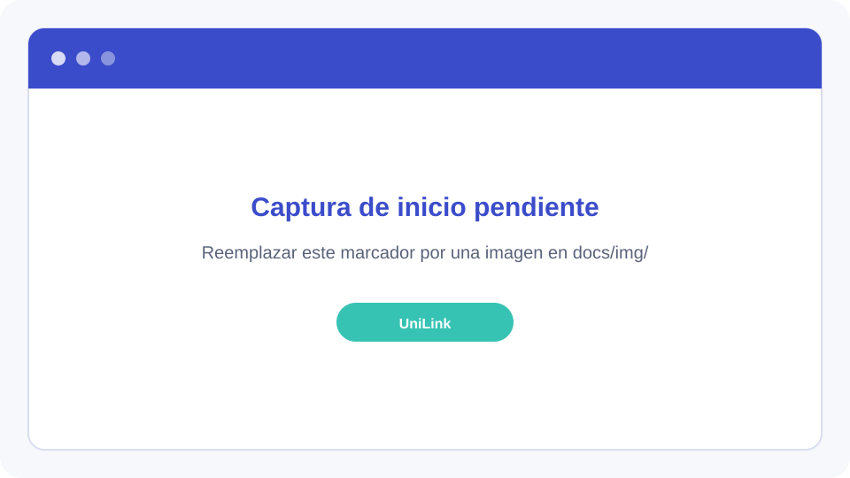
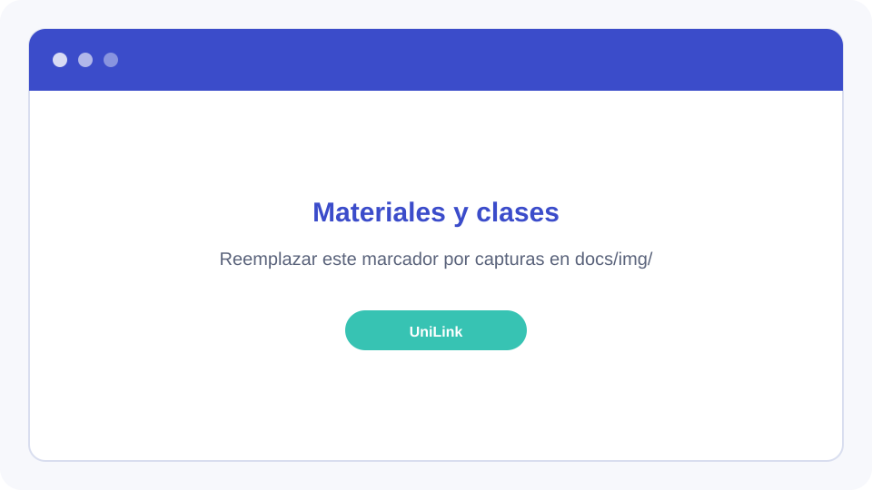
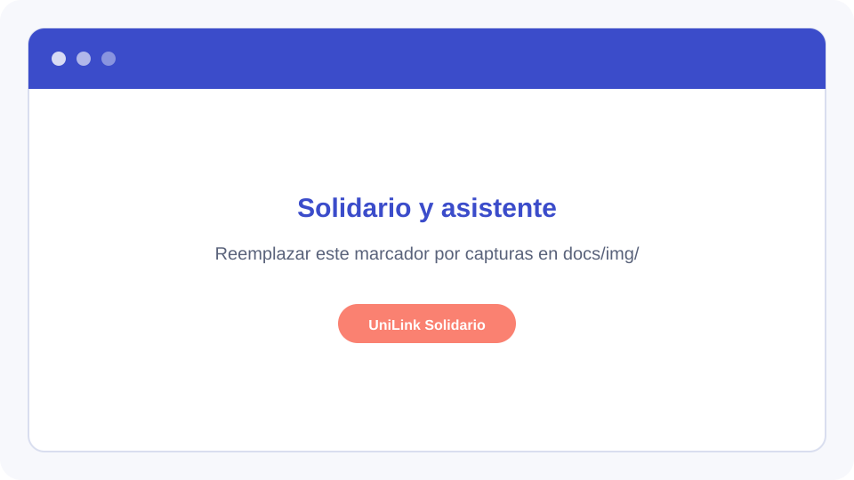
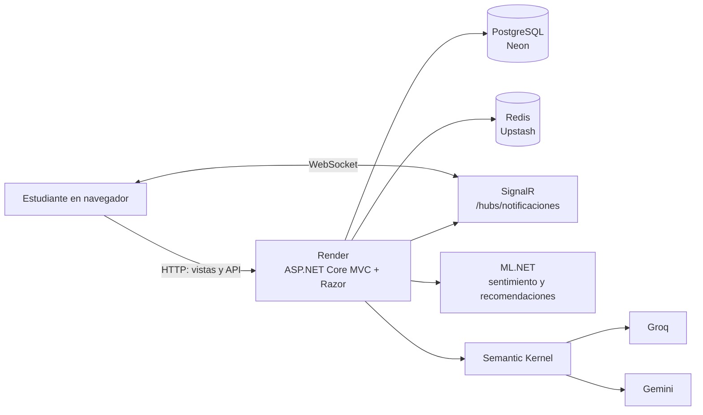

# UniLink

**Conecta, comparte y aprende.**

UniLink es una plataforma para que estudiantes de la Universidad de San Martín de Porres (USMP) compartan recursos académicos, se apoyen entre sí y encuentren oportunidades de aprendizaje.

## El problema y la solución

En carreras como Odontología y Medicina, los instrumentos y equipos necesarios para estudiar pueden ser costosos y se usan solo en momentos puntuales. También es difícil encontrar apoyo académico accesible entre estudiantes.

UniLink conecta a estudiantes de la USMP para que puedan:

- **Compartir materiales:** publicar, descubrir y solicitar en alquiler instrumental, equipos, libros y otros materiales. Cada propietario define el precio por día o puede ofrecerlos gratis.
- **Ofrecer y reservar clases:** encontrar tutorías entre estudiantes, gratuitas o pagadas por hora. La plataforma gestiona la oferta, la reserva y el enlace de reunión; las clases se realizan por Google Meet o Zoom.
- **Participar en UniLink Solidario:** encontrar materiales y clases gratuitas para apoyar a estudiantes que atraviesan dificultades económicas.

Los pagos, si corresponde, se coordinan en persona entre estudiantes. UniLink no procesa pagos ni ofrece carrito, checkout o pasarela de pago.

## Enlaces

- **Aplicación:** [unilink-usmp.onrender.com](https://unilink-usmp.onrender.com)
- **Diseño en Figma:** [DEJAR PLACEHOLDER]
- **Documentación de API:** [`/scalar`](https://unilink-usmp.onrender.com/scalar)
- **Métricas de ML:** [docs/ml-metricas.md](docs/ml-metricas.md)

## Usuarios de prueba

Al iniciar la aplicación con una base de datos sin materiales, el sembrador local crea estos usuarios de demostración y datos de muestra:

| Correo | Contraseña | Perfil |
|---|---|---|
| `ana@usmp.pe` | `Demo123!` | Odontología |
| `diego@usmp.pe` | `Demo123!` | Medicina |
| `valeria@usmp.pe` | `Demo123!` | Ingeniería |

Son cuentas compartidas únicamente para pruebas. No las uses con información real. El sembrador solo inserta el conjunto de datos si todavía no hay materiales; en una base con datos existentes no necesariamente se crearán estas cuentas.

## Capturas

Los siguientes archivos son marcadores visuales. Reemplázalos por capturas reales conservando sus rutas o actualizando los enlaces:

| Inicio | Explorar materiales y clases | Solidario y asistente |
|---|---|---|
|  |  |  |

## Stack tecnológico

- **Aplicación web:** C#, .NET 10, ASP.NET Core MVC y vistas Razor.
- **Identidad y persistencia:** ASP.NET Core Identity, Entity Framework Core, PostgreSQL y migraciones EF Core.
- **Caché y sesiones distribuidas:** Redis con StackExchange.Redis; si Redis no está configurado, la aplicación usa caché en memoria.
- **Tiempo real:** SignalR para notificaciones.
- **Aprendizaje automático:** ML.NET para clasificación de sentimiento de reseñas y recomendaciones.
- **Asistente:** Semantic Kernel con proveedores Groq y Gemini configurables.
- **Interfaz:** Bootstrap 5, JavaScript y CSS.
- **Despliegue:** Render mediante Docker. La arquitectura puede usar PostgreSQL en Neon y Redis en Upstash.
- **Documentación API:** OpenAPI y Scalar.

## Arquitectura



ASP.NET Core MVC concentra las rutas web y API. Entity Framework Core persiste los datos en PostgreSQL; Redis proporciona caché y almacenamiento distribuido cuando está configurado. SignalR entrega notificaciones en tiempo real. ML.NET ejecuta los modelos de sentimiento y recomendaciones, y Semantic Kernel conecta el asistente con los proveedores de lenguaje configurados.

## Tópicos técnicos y ubicación en el código

| Tópico | Ubicación |
|---|---|
| Arranque, configuración de servicios, migraciones automáticas y rutas convencionales | [Program.cs](Program.cs) |
| Entidades y configuración de EF Core | [Models/](Models/), [Data/UniLinkDbContext.cs](Data/UniLinkDbContext.cs) |
| Migraciones de base de datos | [Migrations/](Migrations/) |
| PostgreSQL con Npgsql | [Program.cs](Program.cs), [UniLink.csproj](UniLink.csproj) |
| Sesión del usuario, Identity, registro e inicio de sesión | [Program.cs](Program.cs), [Controllers/CuentaController.cs](Controllers/CuentaController.cs) |
| Mensajes tras redirección (`TempData`) y datos de vistas (`ViewData`) | [Controllers/](Controllers/), por ejemplo [Controllers/MaterialesController.cs](Controllers/MaterialesController.cs) |
| Cookie del filtro más reciente de materiales | [Controllers/MaterialesController.cs](Controllers/MaterialesController.cs) |
| Redis para caché distribuida y protección de datos; alternativa en memoria | [Program.cs](Program.cs), [Services/CategoriaService.cs](Services/CategoriaService.cs) |
| Materiales y operaciones de publicación, edición y eliminación | [Controllers/MaterialesController.cs](Controllers/MaterialesController.cs), [Views/Materiales/](Views/Materiales/) |
| API de clases consumida desde la vista con `fetch` | `GET /api/clases`: [Controllers/ClasesController.cs](Controllers/ClasesController.cs), [wwwroot/js/clases.js](wwwroot/js/clases.js), [Views/Clases/Index.cshtml](Views/Clases/Index.cshtml) |
| API de sentimiento y recomendaciones ML | [Controllers/SentimientoController.cs](Controllers/SentimientoController.cs), [Controllers/RecomendacionesController.cs](Controllers/RecomendacionesController.cs), [ML/](ML/), [Services/RecomendacionService.cs](Services/RecomendacionService.cs) |
| Entrenamiento y evaluación de modelos ML | [ML/](ML/), [docs/ml-metricas.md](docs/ml-metricas.md) |
| Asistente con Semantic Kernel y plugins | [Services/AsistenteService.cs](Services/AsistenteService.cs), [Agente/Plugins/](Agente/Plugins/), [Controllers/AsistenteController.cs](Controllers/AsistenteController.cs) |
| Notificaciones en tiempo real con SignalR | [Hubs/NotificacionesHub.cs](Hubs/NotificacionesHub.cs), [Services/NotificacionService.cs](Services/NotificacionService.cs), [Program.cs](Program.cs) |
| Datos de demostración | [Data/DataSeeder.cs](Data/DataSeeder.cs) |
| Contenedor para despliegue | [Dockerfile](Dockerfile) |

**Métodos HTTP:** las rutas MVC implementan principalmente `GET` y `POST`; las acciones de eliminación también se envían mediante formularios `POST`. La API documentada actualmente incluye `GET /api/clases`, `GET /api/ml/sentimiento` y `GET /api/ml/recomendaciones` (requiere inicio de sesión), además de las rutas `POST` del asistente. No se encontró una ruta `/api/materiales` ni endpoints `PUT`/`DELETE` en el código actual.

## Rutas principales

| Ruta | Función |
|---|---|
| `/` | Página de inicio |
| `/Materiales` | Explorar materiales |
| `/Materiales/Detalle/{id}` | Ver un material |
| `/Clases` | Explorar clases |
| `/Clases/Detalle/{id}` | Ver una clase |
| `/Solidario` | Explorar ofertas solidarias |
| `/Cuenta/Registro` | Crear cuenta |
| `/Cuenta/Login` | Iniciar sesión |
| `/Panel` | Panel del estudiante |
| `/api/clases` | API de clases para explorar y filtrar |
| `/api/ml/sentimiento?texto=...` | Predicción de sentimiento de una reseña |
| `/api/ml/recomendaciones` | Recomendaciones personalizadas (requiere inicio de sesión) |
| `/api/asistente/chat` | Enviar una consulta al asistente (requiere inicio de sesión) |
| `/hubs/notificaciones` | Hub de notificaciones SignalR |
| `/scalar` | Documentación interactiva de API |
| `/health` | Estado de la aplicación, la base de datos y Redis |

## Variables de entorno y configuración

Configura los secretos fuera del repositorio: usa **User Secrets** en desarrollo y variables de entorno en Render. No pongas cadenas de conexión ni claves API en `appsettings.json` o en el código.

| Variable / clave de configuración | Requisito | Uso |
|---|---|---|
| `ConnectionStrings__DefaultConnection` | Obligatoria | Conexión a PostgreSQL |
| `ConnectionStrings__Redis` | Opcional | Redis para caché y claves de Data Protection; sin ella se usa caché en memoria |
| `Groq__ApiKey` | Opcional | Acceso del asistente a Groq |
| `Gemini__ApiKey` | Opcional | Acceso alternativo del asistente a Gemini |
| `PORT` | La proporciona Render | Puerto HTTP asignado en producción |
| `Asistente__Proveedor` | Opcional | Proveedor preferido del asistente |
| `Asistente__ModeloGroq` | Opcional | Modelo de Groq |
| `Asistente__Modelo` | Opcional | Modelo principal de Gemini |
| `Asistente__ModeloAlternativo` | Opcional | Modelo alternativo de Gemini |

Las claves `Asistente__...` pueden configurarse también mediante User Secrets. Los nombres `ConnectionStrings__...` usan la convención de variables de entorno de .NET para las secciones `ConnectionStrings`.

## Ejecutar en local

### Requisitos

- SDK de .NET 10.
- PostgreSQL local o una instancia accesible de PostgreSQL.
- Redis es opcional para desarrollo local.

### Pasos

1. Clona el repositorio y abre una terminal en la carpeta del proyecto.
2. Configura la conexión a PostgreSQL con User Secrets (reemplaza el marcador local por una cadena válida en tu equipo; no la compartas ni la guardes en el repositorio):

   ```powershell
   dotnet user-secrets set "ConnectionStrings:DefaultConnection" "<CADENA_DE_CONEXION_LOCAL>"
   ```

3. Opcionalmente configura Redis y las claves de proveedor del asistente con User Secrets. Sin Redis, la aplicación utiliza caché en memoria; sin claves de proveedor, el asistente no podrá invocar esos modelos.
4. Restaura y ejecuta:

   ```powershell
   dotnet restore UniLink.csproj
   dotnet run --project UniLink.csproj
   ```

5. Abre la URL local que indique `dotnet run`. En el primer inicio, la aplicación intenta aplicar las migraciones y carga los datos de demostración si la base no contiene materiales.

Scalar está disponible en `/scalar` bajo la URL local de la aplicación. Para consultar el estado de servicios, abre `/health`.

## Flujo de trabajo: ramas y Pull Requests

1. Crea una rama de trabajo a partir de `develop`, con un nombre descriptivo, por ejemplo `feature/reservas-clases` o `fix/filtro-materiales`.
2. Mantén los cambios acotados y agrega o actualiza las pruebas y documentación relacionadas.
3. Abre un Pull Request hacia `develop`, describe el propósito, el prompt/agentes/skills usados y las pruebas realizadas, y completa la plantilla [.github/pull_request_template.md](.github/pull_request_template.md).
4. La CI de [.github/workflows/ci.yml](.github/workflows/ci.yml) compila el proyecto para Pull Requests y cambios hacia `develop` y `main`.
5. Integra en `main` los cambios de `develop` que estén listos para desplegar.

## Agentes, skills y prompts

- [AGENTS.md](AGENTS.md) contiene el contexto del producto, reglas de negocio, convenciones y pautas de seguridad para el agente.
- [.github/skills/](.github/skills/) reúne skills del proyecto: diseño UniLink, migraciones EF Core y plugins de Semantic Kernel.
- [.github/agents/](.github/agents/) contiene agentes personalizados, incluido `revisor-unilink`.
- [.github/prompts/](.github/prompts/) contiene prompts reutilizables para nuevas funcionalidades.
- [docs/prompts/](docs/prompts/) conserva prompts y documentación del proceso de construcción del proyecto.

Antes de una tarea, consulta el `AGENTS.md` y utiliza la skill del proyecto que corresponda. En los Pull Requests, registra los agentes o skills usados y el prompt en la plantilla.

## Métricas de aprendizaje automático

Consulta el detalle del conjunto de evaluación, la matriz de confusión y las métricas de los modelos en [docs/ml-metricas.md](docs/ml-metricas.md).
